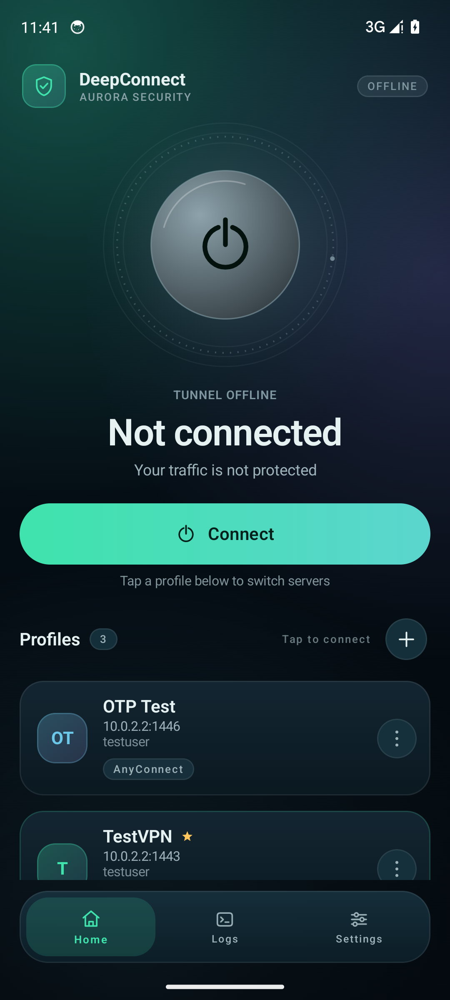
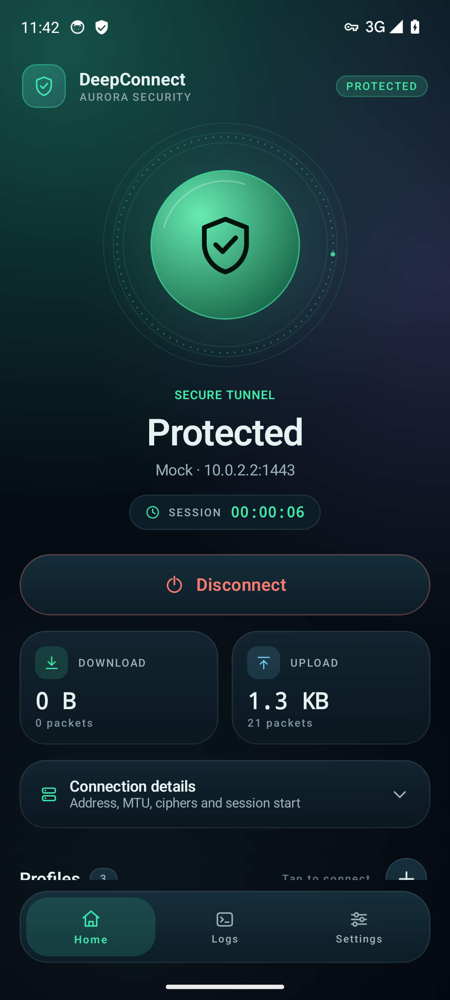
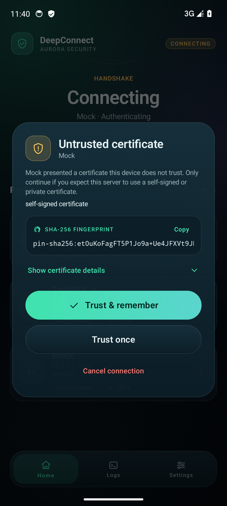
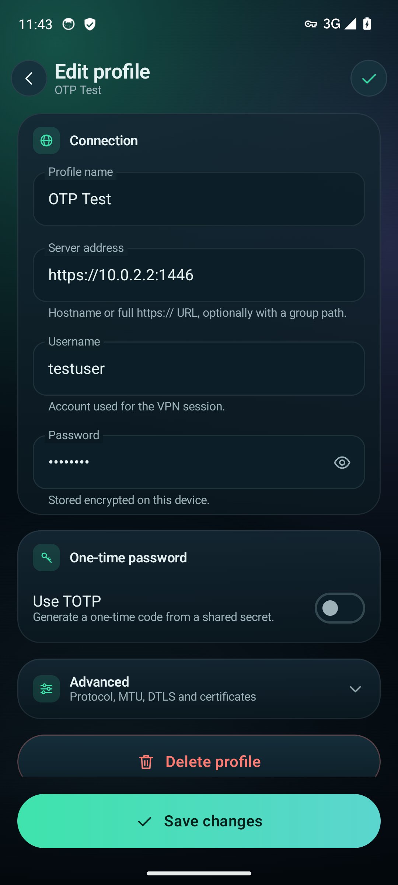
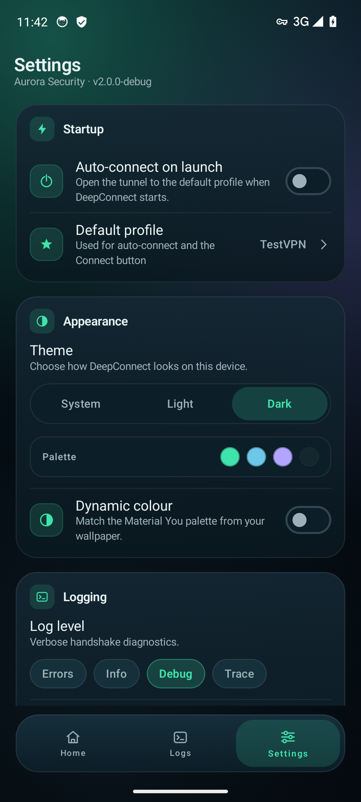
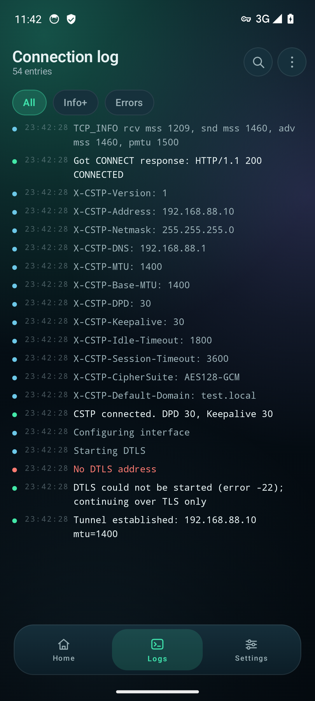

# DeepConnect

An Android OpenConnect VPN client. It speaks the real AnyConnect/OpenConnect
protocol (Cisco AnyConnect, ocserv, Juniper/Pulse, GlobalProtect, Fortinet, F5)
by linking the upstream [OpenConnect](https://www.infradead.org/openconnect/)
library through its official JNI bindings, and it wraps that into a modern
"aurora security" Material 3 UI on top of Android's `VpnService`.

Everything runs inside the app process: no root, no helper binary, no
`run_pie` wrapper, no `--script-tun` shell script. The tun file descriptor is
created by Android and handed to `libopenconnect` with `setupTunFD()`.



## Features

- **Real OpenConnect protocol stack** – the same C library and JNI interface
  that ship with OpenConnect v9.21, cross-compiled for Android
  (`libopenconnect.so`, statically linking OpenSSL 3.0, libxml2 and LZ4).
- **Protocols** – Cisco AnyConnect / ocserv (default), Juniper NC, Pulse
  Secure, Palo Alto GlobalProtect, Fortinet, F5 Big-IP.
- **Saved profiles** – address, username, password, protocol, reported OS,
  MTU, extra CA certificate, pinned certificate, DTLS toggle.
- **Default profile** – the first profile you add automatically becomes the
  default; pick another one from a profile's ⋮ menu. Shown as a *Default* chip
  on the home screen.
- **Auto-connect on launch** – optional (Settings → Startup). When enabled,
  opening the app brings up the tunnel to the default profile immediately
  (requesting the Android VPN permission if needed, then connecting).
- **TOTP** – store the token secret with the profile and let OpenConnect
  generate the code during the handshake (`--token-mode=totp` equivalent).
  Plain Base32 secrets and full `otpauth://` URIs are both accepted; the app
  normalises Base32 to the `base32:` form that OpenConnect requires.
- **Encrypted secrets at rest** – passwords, TOTP secrets and extra CA PEMs
  are encrypted with AES-256-GCM keys held in the Android Keystore.
- **Trust-on-first-use certificate pinning** – unexpected certificates raise a
  blocking dialog showing the reason, SHA-256 pin and certificate details; the
  user can trust once, trust and remember, or cancel.
- **Foreground VPN service** with a live notification, connect/disconnect
  action, and traffic counters.
- **Live diagnostics** – full OpenConnect log (errors/info/debug/trace) with
  timestamps, connection stage, TLS/DTLS ciphers, local address, MTU and DNS.
- **IPv4 and IPv6**, split-tunnel include routes, split-exclude routes on
  Android 13+, DNS servers, live network changes (`setUnderlyingNetworks`).
- **Redesigned UI** – animated connection orb with live session timer, aurora
  gradient backdrop, frosted glass cards, a custom thin-line icon set (no
  Material icon artifacts), bottom navigation, animated traffic counters,
  swipe-to-delete with undo, haptics and motion throughout. System/Light/Dark
  theme plus harmonised Material You dynamic colour; the certificate-trust and
  one-time-password prompts are modal glass dialogs with fingerprint copy.

## Screenshots

| Profiles (dark) | Connected | Certificate trust |
| --- | --- | --- |
|  |  |  |

| Edit profile | Settings | Connection log |
| --- | --- | --- |
|  |  |  |

## Repository layout

```
app/                              Android application module (Kotlin + Compose)
  src/main/java/com/deepconnect/vpn/
    data/                         Profile model, encrypted ProfileStore, settings
    vpn/
      OpenConnectSession.kt       LibOpenConnect subclass: callbacks, auth forms,
                                  TOTP normalisation, certificate trust
      DeepConnectVpnService.kt    VpnService + foreground service + tun lifecycle
      ConnectionController.kt     In-process state bridge for the UI
      CaBundle.kt                 Builds a PEM bundle from Android's system CAs
      VpnNotifier.kt              Foreground notification
      OpenConnectNative.kt        System.loadLibrary() + capability probing
    ui/                           Jetpack Compose screens (Material 3)
    MainActivity.kt               Navigation, VPN consent flow, permission request
  src/main/java/org/infradead/libopenconnect/LibOpenConnect.java
                                  Official OpenConnect JNI Java wrapper (LGPL-2.1,
                                  copied unmodified from the OpenConnect tree)
  src/main/jniLibs/arm64-v8a/libopenconnect.so
  src/main/jniLibs/armeabi-v7a/libopenconnect.so
  src/main/jniLibs/x86_64/libopenconnect.so
native/
  build-openconnect-android.sh    Cross-compiles libopenconnect.so for Android
tools/
  anyconnect_mock.py              Small AnyConnect test gateway used for the
                                  end-to-end tests (see “Testing” below)
.github/workflows/
  ci.yml                          Builds the debug APK on push/PR
  release.yml                     Builds, signs and publishes a release APK
                                  when a v* tag is pushed
docs/screenshots/
```

## Building

### Prerequisites

| Tool | Version used here |
| --- | --- |
| JDK | 17 (Temurin) |
| Android SDK | platform 37 (compileSdk 37), build-tools 37.0.0, targetSdk 36 |
| Android NDK | 27.2.12479018 (only needed to rebuild `libopenconnect.so`) |
| Gradle | 9.9.1 (wrapper included, checksum verified) |
| Android Gradle plugin | 9.5.1 — compiles Kotlin itself ("built-in Kotlin", Kotlin 2.2.10), no `kotlin-android` plugin |
| Jetpack Compose | BOM 2026.09.00 |
| Host build tools | autoconf, automake, libtool, pkg-config, gettext |

Paths are configurable: `JAVA_HOME` and `ANDROID_HOME` are honoured, and
`local.properties` must point at the SDK (`sdk.dir=...`).

### 1. Native library (optional – prebuilt `.so` files are committed)

```bash
# 64-bit ARM phones
ABI=arm64-v8a   ./native/build-openconnect-android.sh
# 32-bit ARM phones
ABI=armeabi-v7a ./native/build-openconnect-android.sh
# x86_64 emulators
ABI=x86_64      ./native/build-openconnect-android.sh
```

The Gradle build automatically packs every ABI that has a
`libopenconnect.so` under `app/src/main/jniLibs/`.

The script downloads (SHA-256-verified) and cross-compiles OpenSSL 3.0.16,
libxml2 2.14.5 and LZ4 1.10.0, copies the OpenConnect source tree into
`native/build/<abi>` and
configures it with `--enable-jni-standalone --with-openssl`, producing a single
self-contained `libopenconnect.so` that is copied into
`app/src/main/jniLibs/<abi>/`. Build products live in `native/build/`
(git-ignored); the source tree used is `$OPENCONNECT_SRC` and the exact upstream
commit the shipped binaries were built from is recorded in
[THIRD_PARTY_NOTICES.md](THIRD_PARTY_NOTICES.md#openconnect--lgpl-21-or-later).
Binaries are reproducible modulo the host toolchain (NDK/autotools versions).

The resulting library only depends on public Android system libraries:

```
DT_NEEDED: libz.so libm.so liblog.so libdl.so libc.so
```

### 2. Application

```bash
./gradlew :app:assembleDebug      # app/build/outputs/apk/debug/app-debug.apk
./gradlew :app:assembleRelease    # signed release APK (needs keystore.properties)
adb install -r app/build/outputs/apk/release/app-release.apk
```

Debug builds use the `com.deepconnect.vpn.debug` application id, so debug and
release builds can be installed side by side. R8/minification stays disabled in
release builds on purpose: the native library looks classes up by name through
JNI, and the proguard rules that keep them are only validated when enabling it.

Release builds are signed with the key described by `keystore.properties`
(git-ignored) at the project root:

```properties
storeFile=/path/to/deepconnect-release.jks
storePassword=<store password>
keyAlias=deepconnect
keyPassword=<key password>
```

`keystore.properties`, `*.jks` and `dist/` are git-ignored, so your signing key
is never committed. In this working copy the release keystore lives **outside**
the repository (`~/.config/deepconnect/deepconnect-release.jks`) and
`keystore.properties` points at it; back both up somewhere safe. Keep the keystore and its passwords if you want to publish
updates: Android only accepts updates to an installed app when the signing key
is unchanged. If `keystore.properties` is missing, Gradle produces an unsigned
APK, which **cannot be installed**; CI builds pass the key through secrets
instead (see [Releasing](#releasing)).

## Using the app

1. **Add profile** (＋) and fill in:
   - *Server address* – `vpn.example.com`, `https://vpn.example.com`, or
     `https://vpn.example.com/group` when the gateway needs a group path/port.
   - *Username* / *Password*.
   - *Use TOTP* – paste the Base32 secret from your authenticator
     (`JBSWY3DPEHPK3PXP`) or a complete
     `otpauth://totp/Issuer:user?secret=…&period=30&digits=6&algorithm=SHA1`
     URI.
   - *Advanced* – protocol, reported OS string, MTU, disable DTLS, extra CA
     certificate (PEM), clear the pinned certificate.
   The first profile you save automatically becomes the **default profile**
   (marked with a *Default* chip). Use a profile's ⋮ menu → **Set as default**
   to pick a different one; deleting the default promotes the next profile.
2. Tap the profile (or the status card) to connect. Android asks for VPN
   permission the first time.
3. If the gateway uses a certificate this device does not trust, a dialog shows
   the SHA-256 pin. Choose **Trust once**, **Trust & remember** (pins it in the
   profile, so the next connects do not prompt) or **Cancel**.
4. When OpenConnect asks for fields the profile does not provide (for example a
   one-time code when no TOTP secret is stored, or an auth group), the app
   prompts and feeds the answer back into the handshake.
5. Optional: **Settings → Startup → Auto-connect on launch** connects to the
   default profile whenever you open the app.
6. The notification and the home card show the tunnel state, elapsed time and
   traffic counters. The log screen shows the full handshake.

## Installing a prebuilt APK

Download `DeepConnect-<version>.apk` from the repository's **Releases** page
(every `v*` tag builds a signed APK automatically, see
[Continuous integration and releasing](#continuous-integration-and-releasing)),
then:

```bash
adb install -r DeepConnect-<version>.apk
# or copy it to the phone, tap it, and allow "install unknown apps"
```

Each release publishes a `.sha256` file as well; verify it after transferring
the APK if you downloaded it over a chat app or cloud drive.

For local development `./gradlew :app:assembleDebug` produces
`app/build/outputs/apk/debug/app-debug.apk` (package
`com.deepconnect.vpn.debug`, Android debug signing) for `adb logcat` sessions.


### Troubleshooting installation

| Symptom | Cause / fix |
| --- | --- |
| `packageInfo is null`, 解析包错误, "There was a problem parsing the package" | Almost always an **unsigned APK** (e.g. `app-release-unsigned.apk`) or a **truncated transfer**. Use `DeepConnect-<version>.apk`; if you copied it over a chat app, compare `shasum -a 256` with the value below. |
| `INSTALL_FAILED_NO_MATCHING_ABIS` | Phone ABI not in the APK. The shipped APK covers ARM64, ARMv7 and x86_64. |
| `INSTALL_FAILED_OLDER_SDK` | Phone is older than Android 8.0 (API 26). |
| `INSTALL_FAILED_UPDATE_INCOMPATIBLE` | A build signed with a different key is installed (e.g. the old debug build or a previous release key). Uninstall it first: `adb uninstall com.deepconnect.vpn`. |
| Log shows `DTLS handshake failed: 2` | The optional UDP side channel could not be established: the gateway did not answer on its DTLS/UDP port within 12 s, usually because a firewall/NAT on this network filters UDP. `2` is OpenSSL's `SSL_ERROR_WANT_READ`. The tunnel keeps working over TLS; DTLS is only a latency optimisation and is retried periodically. Compare `DTLS (UDP)` in the connected card (cipher = active, `unavailable (TLS only)` = UDP path blocked/not offered). To stop the retries, edit the profile → Advanced → *Disable DTLS*. |

Diagnostics to collect:

```bash
adb shell getprop ro.build.version.release   # Android version
adb shell getprop ro.product.cpu.abilist     # supported ABIs
adb install -r DeepConnect-<version>.apk    # adb prints the real error code
```

## How it works

```
┌──────────────────────────── Android app process ─────────────────────────────┐
│  Compose UI ── StateFlow ── ConnectionController                              │
│                                  │                                            │
│                        DeepConnectVpnService (VpnService, foreground)          │
│                          │  1. VpnService.Builder from OpenConnect IP info    │
│                          │  2. ParcelFileDescriptor.establish() → tun fd      │
│                          │  3. LibOpenConnect.setupTunFD(tun fd)              │
│                          ▼                                                    │
│  OpenConnectSession (subclass of org.infradead.libopenconnect.LibOpenConnect) │
│    parseURL → obtainCookie (auth forms) → makeCSTPConnection →               │
│    setupDTLS → mainloop(300, 10)                                              │
│                                  │  JNI        ▲ callbacks                   │
│                          libopenconnect.so (OpenSSL, libxml2, LZ4 linked in)  │
└──────────────────────────────────┼────────────────────────────────────────────┘
                                   │ TLS/DTLS to the gateway
```

* Auth forms arrive on the network thread; the Kotlin subclass fills stored
  credentials, lets the library generate TOTP codes, and only blocks the
  handshake thread for prompts the user must answer (certificate trust, manual
  OTP). A prompt can never wedge the tunnel: `cancel()` aborts the handshake.
* `onProtectSocket()` is wired to `VpnService.protect()` so the TLS/DTLS sockets
  never route back into the tunnel (needed for reconnects and DTLS).
* The TUN interface is torn down by closing the `ParcelFileDescriptor`; the
  library sends its CSTP `BYE` packet first.
* `CaBundle` concatenates Android's system CA store
  (`/apex/com.android.conscrypt/cacerts`, `/system/etc/security/cacerts`) into a
  PEM file and passes it via `setCAFile()`, because OpenConnect's OpenSSL
  backend does not know Android's CA layout. Extra per-profile CAs are appended.

## Continuous integration and releasing

Two GitHub Actions workflows are included:

| Workflow | Trigger | What it does |
| --- | --- | --- |
| `.github/workflows/ci.yml` | push to `main`/`master`, pull requests, manual | Builds `app-debug.apk` on Ubuntu, verifies the zip, uploads it as a workflow artifact. |
| `.github/workflows/release.yml` | push of a `v*` tag, manual run | Builds and **signs** the release APK, verifies it with `apksigner`, then creates a GitHub Release with `DeepConnect-<version>.apk` and its `.sha256`. Manual runs upload the APK as an artifact instead of creating a release. |

### Releasing

1. Add these repository secrets (Settings → Secrets and variables → Actions):

   | Secret | Value |
   | --- | --- |
   | `ANDROID_KEYSTORE_BASE64` | `base64 -i /path/to/your-release.jks \| tr -d '\n'` |
   | `ANDROID_KEYSTORE_PASSWORD` | keystore password |
   | `ANDROID_KEY_ALIAS` | key alias, e.g. `deepconnect` |
   | `ANDROID_KEY_PASSWORD` | key password |

2. Create and push a tag:

   ```bash
   git tag v1.0.0
   git push origin v1.0.0
   ```

   The workflow publishes a release containing the signed APK and its SHA-256.
   You can also run the workflow manually (`workflow_dispatch`) to get an APK
   artifact without creating a release.

3. Keep the keystore safe and backed up: without it you cannot ship updates to
   an already-installed app.

## Security

- Passwords, TOTP secrets and extra CA PEMs are encrypted with AES-256-GCM keys
  generated in the Android Keystore; the key material never leaves the device.
- No telemetry, analytics, crash reporting or third-party SDKs are bundled.
- TLS certificates are validated by OpenSSL against Android's system CA store
  (plus an optional per-profile CA); unexpected certificates require explicit
  user approval and can be pinned (trust-on-first-use).
- `allowBackup`/device-transfer are disabled so encrypted secrets are not
  copied to other devices.
- CI uses repository secrets for the signing key; no keys, keystores or
  passwords are committed, and the maintainer's keystore is kept outside the
  repository. See [SECURITY.md](SECURITY.md) for the full policy and how to
  report a vulnerability.

## Testing

`tools/anyconnect_mock.py` is a small Python AnyConnect-compatible gateway that
can validate a login, verify the TOTP code that the client library generated
(RFC 6238, SHA-1), open a CSTP tunnel and answer ICMP echo requests. It was
used to validate the app end-to-end on an Android 14 arm64 emulator:

```bash
# self-signed certificate for the test gateway
mkdir -p ~/vpn-test/mock && cd ~/vpn-test/mock
openssl req -x509 -newkey rsa:2048 -keyout server.key -out server.crt \
  -days 3650 -nodes -subj "/CN=deepconnect.test"

# start the gateway (TOTP optional – omit TOTP_SECRET for password-only)
CERT_DIR=$PWD TOTP_SECRET=JBSWY3DPEHPK3PXP \
  python3 /path/to/DeepConnect/tools/anyconnect_mock.py 1443
```

Then add a profile with server `https://10.0.2.2:1443` (emulator alias for the
host), user `testuser`, password `testpass` and the same TOTP secret.

Verified end-to-end:

| Check | Result |
| --- | --- |
| TLS with self-signed cert → trust dialog → pin saved | ✔ |
| TOTP code generated by libopenconnect accepted by the gateway | ✔ |
| CSTP `CONNECT /CSCOSSLC/tunnel` established | ✔ |
| TUN interface up: `192.168.88.10/24`, MTU 1400, DNS from server | ✔ |
| Bidirectional data path: `ping 192.168.88.1` over the tunnel, 3/3 replies | ✔ |
| Traffic counters/notification update | ✔ |
| Disconnect sends CSTP `BYE`, TUN removed | ✔ |
| Reconnect with pinned certificate (no prompt), fresh TOTP | ✔ |
| Password-only profile without TOTP | ✔ |
| First profile auto-marked as *Default*; ⋮ → Set as default moves the chip | ✔ |
| Auto-connect on launch connects silently to the default profile; no-op when disabled | ✔ |
| Split-tunnel routes in `netmask` form (`192.0.2.57/255.255.255.255`) installed: internal host routed `dev tun0`, ping 2/2, HTTPS page loaded (≈1.3 MB through the tunnel) | ✔ |
| DTLS side channel established and DPDs answered (when the network permits UDP); fallback to TLS-only when UDP is filtered | ✔ |

Interoperability with a stock `ocserv` 1.2.4 gateway was also attempted in a
Linux VM; the same client failed identically with the upstream `openconnect`
CLI (server-side `plain` auth configuration issue), so it is not covered by
these results. Real-world gateways are expected to work because the app drives
the same unmodified library code path as the CLI.

## Changelog

- **2.0.0** — full UI redesign ("Aurora Security"): animated connection orb
  with live session timer, aurora gradients, custom thin-line icon set (the
  deprecated Material icon artifacts were removed), floating glass bottom
  navigation, redesigned log viewer with filters/search/copy/share and
  auto-follow, restructured settings with theme mode (System/Light/Dark) and
  harmonised dynamic colour, redesigned profile editor with validation and an
  unsaved-changes guard, swipe-to-delete with undo, haptics and motion
  throughout, new adaptive launcher icon. Toolchain upgraded to AGP 9.5.1 /
  Gradle 9.9.1 / built-in Kotlin 2.2.10 / Compose BOM 2026.09.00 /
  compileSdk 37 / targetSdk 36, AndroidX core-ktx 1.19.1,
  activity-compose 1.13.0, lifecycle 2.11.0, navigation-compose 2.10.2,
  coroutines 1.11.0; GitHub Actions bumped to checkout@v7, setup-java@v6,
  gradle/actions@v6, upload/download-artifact v7/v8, action-gh-release@v3.
- **1.1.2** — fix split-tunnel routes: OpenConnect reports `X-CSTP-Split-Include` as
  `address/netmask`, which the CIDR parser rejected, so every split route was
  silently dropped and internal resources were unreachable through the tunnel on
  networks that need the VPN. Both `netmask` and CIDR spellings are accepted now;
  installed routes are logged.
- **1.1.1** — surface the optional DTLS (UDP) side channel in the UI, explain
  `DTLS handshake failed: 2` (`SSL_ERROR_WANT_READ` → UDP filtered on the network,
  tunnel still runs over TLS), log `VpnService.protect()` outcomes.
- **1.1.0** — default profile, auto-connect on launch, GitHub Actions CI/release
  workflows, prebuilt signed APK fixes, security hardening.
- **1.0.0** — initial release: OpenConnect JNI client, saved profiles with
  Keystore-encrypted secrets, TOTP, certificate pinning, Compose UI.

## Known limitations

- **SAML / SSO browser authentication is not implemented.** Gateways that
  require `single-sign-on` return a clear error in the log. Username/password
  and TOTP (the requested features) are fully supported.
- **No client-certificate UI yet.** The library supports certificates; adding
  file import + `setClientCert()` would be a small follow-up.
- Split-*exclude* routes require Android 13+ (`VpnService.Builder.excludeRoute`).
- One connection at a time. Connecting while another profile is active is
  rejected with a hint in the log.
- DTLS is an optional UDP side channel: when a network blocks UDP the tunnel
  silently continues over TLS and only the log/`DTLS (UDP)` row shows it. This
  is expected behaviour, not an error in the connection.
- Shipped ABIs: `arm64-v8a`, `armeabi-v7a`, `x86_64` (Android 8.0+/API 26 minimum).

## Licenses

- App code: MIT — see [LICENSE](LICENSE).
- Bundled `libopenconnect.so` and `LibOpenConnect.java`: OpenConnect,
  LGPL-2.1-or-later — see [THIRD_PARTY_NOTICES.md](THIRD_PARTY_NOTICES.md).
  The native library is statically linked into the APK; complete corresponding
  sources are available in the OpenConnect upstream tree and can be rebuilt with
  `native/build-openconnect-android.sh`.
- Statically linked into `libopenconnect.so`: OpenSSL 3.0 (Apache-2.0),
  libxml2 (MIT), LZ4 (BSD-2-Clause).
